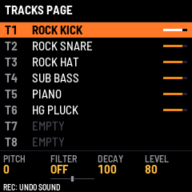

# STACK

**Clock Anything.** · STACK Studio Chain

STACK is Maker Hip's own firmware for the M-VAVE FM-1: eight tracks, each with one sound from 69 built-in sounds or a
sample sent from the Burger Studio app, DJ-style effects, ENV, LFO, EDIT and ARP per track, a 16-step sequencer, a
looper on track 8, PERFORM (effects on everything from the white keys), SAVE, and MIDI clock in or out over USB and
Bluetooth.

- **Install:** https://perawoga2-coder.github.io/stack/ (Chrome or Edge, the FM-1 on USB). The installer can also
  put M-VAVE's own firmware back.
- **Manual:** https://perawoga2-coder.github.io/stack/manual/
- **Releases:** [GitHub releases](https://github.com/perawoga2-coder/stack/releases), each with its `.fwsc`, built
  and attested by [The Firmware Hub's shared workflow](https://github.com/zvenson/fm1-build) (`.github/workflows/release.yml`).

This is a public beta. Not everything is finished, and it has not been tried on many FM-1s yet.

## Source

The firmware is in [`stack/`](stack/) ([`stack/README.md`](stack/README.md) says how to build it). It is built on
[fm1-base](https://github.com/charlesvestal/fm1-base) and felucca-bsp, which come from Felucca by Leo Kuroshita,
Hügelton Instruments. `build.sh` is the build the release workflow runs.

## Licence

MPL-2.0 ([`LICENSE`](LICENSE)), file by file. What comes from where is in [`stack/LICENSING.md`](stack/LICENSING.md)
and [`stack/CREDITS.md`](stack/CREDITS.md).

M-VAVE and FM-1 are trademarks of their owners. STACK is not affiliated with or endorsed by M-VAVE.
