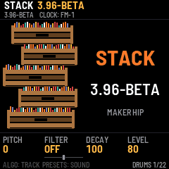
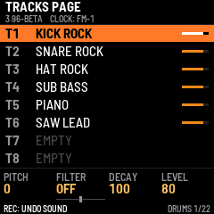
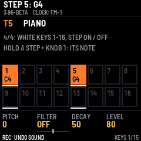
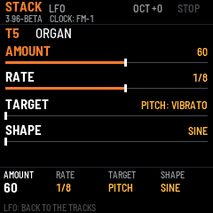
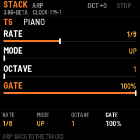
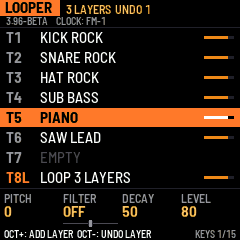
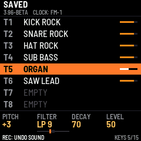

# STACK manual

STACK is a firmware for the M-VAVE FM-1, made by Maker Hip. This manual is for version 3.96-beta.

## Read this first

- **This is a beta.** Not everything is finished. Some things may go wrong. Please tell us what you find.
- **Do not hold REC when you switch the FM-1 on.** Do not hold OCT− and OCT+ together when you switch it on.
  Those key holds belong to the FM-1's start-up and update system, not to STACK.
- **The loop on track 8 is gone when you switch off.** It is never saved. To keep it, record it into Burger Studio.
- **Samples sent from Burger Studio may be gone after you switch off.** Send them again if a track shows EMPTY.
- **Your song is saved only when you press SAVE.** STACK never saves by itself.

## The idea

STACK has eight tracks. Each track plays one sound. You pick a track, pick its sound, and play it with the keys.
A 16-step sequencer plays the tracks for you. Track 8 can become a looper that records what you play.

## The play page

This is the page you see after the start. It lists the eight tracks, T1 to T8.

| Control | What it does |
|---|---|
| ALGORITHM knob | Selects the track. It stops at T1 and at T8. |
| PRESETS knob | Changes the sound of the selected track. |
| The keys | Play the selected track. |
| OCT− / OCT+ | Move the keys one octave down or up. They act when you let go. |
| K1 PITCH | Tunes the track, in semitones, −24 to +24. |
| K2 FILTER | A DJ filter. Left closes a low-pass. Right opens a high-pass. The middle is OFF. |
| K3 DECAY | How long the sound rings. For a drum: how fast it fades. For a held sound: how fast it lets go. |
| K4 LEVEL | The track's volume. |
| MASTER | The volume of the FM-1's speaker and headphone jack. |
| PLAY | Starts and stops the sequencer. |
| REC | Undo: puts back the sound a track had before your last turn of PRESETS. |

### The sound list

All sounds are in one list. The list starts with EMPTY. Then come 69 built-in sounds, in groups: DRUMS, BASS, KEYS,
PAD, LEAD, FX. The last three places are MY 1, MY 2 and MY 3: the samples you send from Burger Studio.

Turn PRESETS slowly to go sound by sound. The list stops at both ends. The bottom line of the screen shows the
group and the place, for example `KEYS 3/15`.

Tracks 1 to 6 start with a sound. Tracks 7 and 8 start EMPTY.

### REC: undo the sound

If you turn PRESETS by mistake, press REC. The track gets back the sound it had. The REC light is on while there is
something to undo.

## The step page (SEQ)

Press SEQ to open the step page for the selected track. Press SEQ again to go back.

- The white keys are the steps. Tap a white key to switch a step on or off.
- Hold a step and turn K1 to set its note. A drum always plays its own pitch.
- Press PLAY. The steps that are on play in a loop. The step that sounds lights up.
- A small mark under a step shows where a beat starts.

All eight tracks share the same pattern length. The length comes from the time signature (EDIT page 2).

## FX

Press FX to open the page. Press FX again to go back. Each track has two effect slots, A and B.

| Knob | What it does |
|---|---|
| K1 | Picks the effect in slot A. |
| K2 | The amount of slot A. The middle is off. Left and right give two flavours. |
| K3 | Picks the effect in slot B. |
| K4 | The amount of slot B. |

| Effect | Knob left | Knob right |
|---|---|---|
| DELAY | SLAP | LONG (in time with the tempo) |
| ECHO | SHORT | ENDLESS |
| REVERB | ROOM | HALL |
| TAPE SPEED | SLOW | FAST |
| ROBOT | METAL | ROBOT |
| FLANGER | DEEP | SHARP |
| OVERDRIVE | WARM | FUZZ |
| CHORUS | WIDE | WOBBLE |
| LO-FI | VINYL | 8-BIT |

## ENV

Press ENV to open the page. Press ENV again to go back. It shapes the selected track.

| Knob | What it does |
|---|---|
| K1 ATTACK | How slowly the sound fades in. 0 is at once. |
| K2 RELEASE | How long the sound rings after you let go. AUTO follows DECAY. |
| K3 SUSTAIN | The level a held sound settles at. Drums do not use it. |
| K4 VELOCITY | How much a harder press plays louder. 0 is always the same. |

## LFO

Press LFO to open the page. Press LFO again to go back. An LFO is a slow wave that moves one thing. Each track has
one.

| Knob | What it does |
|---|---|
| K1 AMOUNT | How strong. 0 is OFF. |
| K2 RATE | How fast, in time with the tempo: 4 BARS to 1/32. T means triplet. |
| K3 TARGET | PITCH (vibrato), FILTER (wah), LEVEL (tremolo) or PAN (left and right). |
| K4 SHAPE | SINE, TRIANGLE, SQUARE, SAW UP or SAW DOWN. |

PITCH starts again at every note. The other targets follow the bar while the sequencer plays.

## EDIT, page 1

Press EDIT to open page 1. It changes how the selected track plays its sound.

| Knob | What it does |
|---|---|
| K1 START | Where the sound starts, in per cent. |
| K2 REVERSE | ON plays the sound backwards. |
| K3 LOOP | AUTO plays the sound as it is. OFF plays it once. ON loops it. |
| K4 LENGTH | How much of the sound plays after START. 100% is to the end. |

Only four notes can play backwards at the same time. On a sample from Burger Studio, EDIT works a moment after the
sample has arrived.

## EDIT, page 2

Press EDIT again to open page 2. Press EDIT once more to go back to the tracks.

| Knob | What it does |
|---|---|
| K1 SWING | Moves every second sixteenth later. 50% is straight. For all tracks. |
| K2 FIT | Makes the sound last 1/4, 1/2, 1, 2 or 4 bars. The pitch changes with the speed. For this track. |
| K3 TIME SIG | 2/4, 3/4, 4/4, 6/8 or 7/8. It sets the number of steps. For all tracks. |
| K4 TEMPO | 40 to 240 BPM. For all tracks. |

When the FM-1 follows a clock from outside, that clock sets the tempo and K4 does nothing.

## ARP

Press ARP to open the page. Press ARP again to go back. The arpeggiator plays the keys you hold, one after another.

| Knob | What it does |
|---|---|
| K1 RATE | OFF, or 1/4 to 1/32. T means triplet. OFF plays the keys normally. |
| K2 MODE | UP, DOWN, UP-DOWN, or ORDER (the order you pressed the keys). |
| K3 OCTAVE | 1, 2 or 3 octaves. |
| K4 GATE | How long each note is, 10% to 100% of a step. |

Hold a chord and it runs. Let go and it stops. It runs in time with the sequencer.

## The looper (OCT− and OCT+ together)

Track 8 can be a looper. A loop is as long as one pattern.

1. Press OCT− and OCT+ **together**. The screen shows LOOPER. Track 8 shows T8L.
2. Press PLAY.
3. Select a track from T1 to T7.
4. Press OCT+. Recording starts at the next bar and stops by itself after one pattern.
5. Play the keys while it records. What you play becomes a layer of the loop.
6. Press OCT+ again to add another layer.

| Control (in looper mode) | What it does |
|---|---|
| OCT+ | Records one more layer. |
| OCT− (short) | Removes the last layer. Only one layer can be removed. |
| OCT− (hold) | Clears the whole loop. A bar fills while you hold. |
| OCT− and OCT+ together | Leaves looper mode. The loop keeps playing. |

- Only what you play by hand is recorded. The sequencer's own steps are not recorded.
- If track 8 already has a sound, the screen says `TRACK 8 IN USE`. Hold OCT− to clear track 8 first.
- On T8L the keys are silent. Select T1 to T7 to play.
- The loop is gone when you switch off.
- If you change the tempo or the time signature, the loop no longer fits. The screen says `LOOP OUT OF TIME`.
  Clear the loop and record it again.

## GLO: Bluetooth

Press GLO to open the page. Press GLO again to go back.

| Control | What it does |
|---|---|
| K1 BLUETOOTH | ON or OFF. |
| STATUS | CONNECTED, WAITING or OFF. |
| REC | Disconnects. The FM-1 can then be found again. |

Over Bluetooth the FM-1 sends its key notes and its clock, and it plays notes it receives. A small `BT` in the top
of the screen shows that something is connected. Samples and audio need the USB cable.

## Clock

The second line of the screen shows who sets the tempo.

- `CLOCK: FM-1`: the FM-1 leads. It sends MIDI clock, Start and Stop over USB and Bluetooth.
- `CLOCK: BURGER`: a clock comes in over USB. The FM-1 follows it.
- `CLOCK: BT`: a clock comes in over Bluetooth. The FM-1 follows it. For the looper, the cable is steadier.

You do not set this on the FM-1. If a clock comes in, the FM-1 follows it. If the clock stops, the FM-1 leads again
after half a second, at the same tempo.

## Samples from Burger Studio

Burger Studio is Maker Hip's app. It sends samples to the FM-1 over the USB cable.

- A sample lands in MY 1, MY 2 or MY 3, at the end of the sound list.
- If track 7 or 8 is empty, the new sample goes there, and the screen tells you.
- A slot that could not be read shows a note in the list, such as `(EMPTY)` or `(BAD …)`.
- When the FM-1's screen shows `SOUND IN BURGER`, the app has muted the FM-1's own speaker and plays the FM-1's
  sound itself.

## SAVE

Press SAVE to save your song. The screen says `SAVED`.

What is saved: every track's sound and knobs, FX, ENV, LFO, EDIT, ARP, the steps and their notes, the tempo, the
time signature, the swing, and Bluetooth on or off.

What is **not** saved: the loop on track 8, and the samples themselves.

- **Stop first.** While the sequencer plays, the screen says `STOP TO SAVE`. Saving stops the sound for a moment.
- The song loads by itself when you switch on.
- If a saved track used a sample that is no longer there, that track is EMPTY.
- **To clear the saved song:** stop, then hold SAVE for two seconds. A bar fills. Then the screen says
  `SAVED SONG CLEARED` and the FM-1 is as new.

## The city view

While the sequencer plays and you touch nothing for ten seconds, the screen shows a city at night. The eight signs
on the buildings are level meters, one for each track: T1 near left, T2 near right, and so on down the street.
Green is quiet, yellow is loud, red is very loud. The white bar holds the peak. The looper's sign is purple.

- Press any button or turn any knob to go back. That first touch only brings the page back. It changes nothing.
- The keys still play while the city shows.
- Hold HOME to open the city view at any time.
- It does not appear on the other pages or in looper mode.
