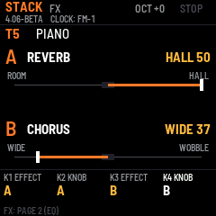
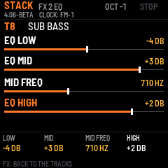
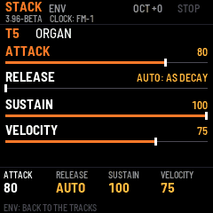
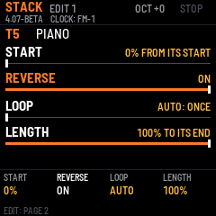
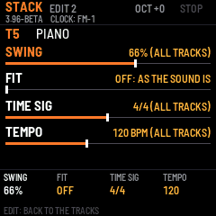
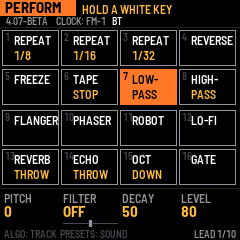
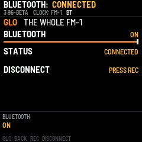
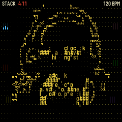

# STACK manual

STACK is a firmware for the M-VAVE FM-1, made by Maker Hip. This manual is for version 4.07-beta.

## Read this first

- **This is a beta.** Not everything is finished. Some things may go wrong. Please tell us what you find.
- **Do not hold REC when you switch the FM-1 on.** Do not hold OCT− and OCT+ together when you switch it on.
  Those key holds belong to the FM-1's start-up and update system, not to STACK.
- **The loop is gone when you switch off.** It is never saved. To keep it, record it into Burger Studio.
- **Samples sent from Burger Studio may be gone after you switch off.** Send them again if a track shows EMPTY.
- **Your song is saved only when you press SAVE.** STACK never saves by itself.

## The idea

STACK has eight tracks. Each track plays one sound. You pick a track, pick its sound, and play it with the keys.
A 16-step sequencer plays the tracks for you. Press REC and the looper records what you play, on track 8 or 7.

## The play page

This is the page you see after the start. It lists the eight tracks, T1 to T8.

| Control | What it does |
|---|---|
| ALGORITHM knob | Selects the track. It stops at T1 and at T8. |
| PRESETS knob | Changes the sound of the selected track. |
| The keys | Play the selected track. |
| OCT− / OCT+ | Move the keys one octave down or up. They act when you let go. |
| K1 PITCH | Tunes the track, in semitones, −24 to +24. |
| K2 FILTER | A DJ filter. Left closes a low-pass. Right opens a high-pass. The middle is OFF. |
| K3 DECAY | How long the sound rings. For a drum: how fast it fades. For a held sound: how fast it lets go. |
| K4 LEVEL | The track's volume. |
| MASTER | The volume of the FM-1's speaker and headphone jack. |
| PLAY | Starts and stops the sequencer. |
| SELECT knob | The tempo, 40 to 240 BPM. One click is 1 BPM. It works on every page. |
| REC | The looper. Press it and it records at once. See "The looper (REC)". |

### The sound list

All sounds are in one list. The list starts with EMPTY. Then come 69 built-in sounds, in groups: DRUMS, BASS, KEYS,
PAD, LEAD, FX. The last three places are MY 1, MY 2 and MY 3: the samples you send from Burger Studio.

Turn PRESETS slowly to go sound by sound. The list stops at both ends. The bottom line of the screen shows the
group and the place, for example `KEYS 3/15` or `MY 2/3`. While you turn, the top of the screen shows where you
are now: the group and the place, and the sound, for example `FX 2/5 RAIN`.

Tracks 1 to 6 start with a sound. Tracks 7 and 8 start EMPTY.

All built-in sounds are equally loud. Since 4.06 the noises WIND and RAIN (FX) have no rumble under 150 Hz any more:
before, they held more deep bass than any other sound, and it sat under the whole mix.

### SELECT: the tempo

Turn the SELECT knob to change the tempo. One click is 1 BPM, from 40 to 240. The top of the screen shows the new
tempo for a moment. It is the same tempo as K4 on EDIT page 2, and it works on every page.

When the FM-1 follows a clock from outside, that clock sets the tempo. SELECT then changes nothing, and the screen
says who leads.

## The step page (SEQ)

Press SEQ to open the step page for the selected track. Press SEQ again to go back.

- The white keys are the steps. Tap a white key to switch a step on or off.
- Hold a step and turn K1 to set its note. A drum always plays its own pitch.
- Press PLAY. The steps that are on play in a loop. The step that sounds lights up.
- A small mark under a step shows where a beat starts.

All eight tracks share the same pattern length. The length comes from the time signature (EDIT page 2).

## FX

Press FX to open the page. Press FX again for page 2, the EQ (below). Press FX once more to go back to the tracks.
Each track has two effect slots, A and B.

| Knob | What it does |
|---|---|
| K1 | Picks the effect in slot A. |
| K2 | The amount of slot A. The middle is off. Left and right give two flavours. |
| K3 | Picks the effect in slot B. |
| K4 | The amount of slot B. |

| Effect | Knob left | Knob right |
|---|---|---|
| DELAY | SLAP | LONG (in time with the tempo) |
| ECHO | SHORT | ENDLESS |
| REVERB | ROOM | HALL |
| TAPE SPEED | SLOW | FAST |
| ROBOT | METAL | ROBOT |
| FLANGER | DEEP | SHARP |
| OVERDRIVE | WARM | FUZZ |
| CHORUS | WIDE | WOBBLE |
| LO-FI | VINYL | 8-BIT |

## FX, page 2: EQ

Press FX twice to open the EQ: three bands that make the track's low, middle and high louder or softer. Each track
has its own. It works on everything the track plays: your keys, its steps and the loop on T8L or T7L.

| Knob | What it does |
|---|---|
| K1 LOW | The lows, under about 150 Hz: −15 to +6 dB. |
| K2 MID | The middle, around MID FREQ: −15 to +6 dB. |
| K3 MID FREQ | Where the middle is: 160 Hz to 6300 Hz. It starts at 1000 Hz. |
| K4 HIGH | The highs, over about 5000 Hz: −15 to +6 dB. |

0 dB is off. When all three are at 0 dB the track sounds exactly as without an EQ. The EQ comes after the FILTER and
before the effects. SAVE keeps it. A song saved before 4.06 loads with the EQ off.

## ENV

Press ENV to open the page. Press ENV again to go back. It shapes the selected track.

| Knob | What it does |
|---|---|
| K1 ATTACK | How slowly the sound fades in. 0 is at once. |
| K2 RELEASE | How long the sound rings after you let go. AUTO follows DECAY. |
| K3 SUSTAIN | The level a held sound settles at. Drums do not use it. |
| K4 VELOCITY | How much a harder press plays louder. 0 is always the same. |

## LFO

Press LFO to open the page. Press LFO again to go back. An LFO is a slow wave that moves one thing. Each track has
one.

| Knob | What it does |
|---|---|
| K1 AMOUNT | How strong. 0 is OFF. |
| K2 RATE | How fast, in time with the tempo: 4 BARS to 1/32. T means triplet. |
| K3 TARGET | PITCH (vibrato), FILTER (wah), LEVEL (tremolo) or PAN (left and right). |
| K4 SHAPE | SINE, TRIANGLE, SQUARE, SAW UP or SAW DOWN. |

PITCH starts again at every note. The other targets follow the bar while the sequencer plays.

## EDIT, page 1

Press EDIT to open page 1. It changes how the selected track plays its sound.

| Knob | What it does |
|---|---|
| K1 START | Where the sound starts, in per cent. |
| K2 REVERSE | ON plays the sound backwards. |
| K3 LOOP | AUTO: a sound with its own loop loops; a drum plays once; any other sound holds while you hold a key (see below). OFF plays it once. ON loops it. |
| K4 LENGTH | How much of the sound plays after START. 100% is to the end. |

**Long notes (LOOP on AUTO).** Hold a key and the note sounds for as long as you hold it, also on sounds that
end by themselves (piano, plucks, bells, some basses and FX, and your own samples MY 1 to 3). When the sound has
played about two thirds of its length, it holds on a short loop there. Let go and the rest of the sound plays out
and fades as RELEASE says. START and LENGTH move the place: a shorter LENGTH holds an earlier, louder part.

- Drums play once, as always.
- Steps of the sequencer play the sound once, as always. Only keys you hold (and the ARP's notes) are held.
- LOOP OFF plays the sound once, also under a held key. A sound that FIT stretches to bars is not held either, nor
  a sound played backwards (REVERSE ON): the screen then says `AUTO: ONCE`.
- A held note has a steady, organ-like tone. It no longer fades by itself, so a piano held for long does not
  sound like a real piano.

Only four notes can play backwards at the same time. On a sample from Burger Studio, EDIT works a moment after the
sample has arrived.

## EDIT, page 2

Press EDIT again to open page 2. Press EDIT once more to go back to the tracks.

| Knob | What it does |
|---|---|
| K1 SWING | Moves every second sixteenth later. 50% is straight. For all tracks. |
| K2 FIT | Makes the sound last 1/4, 1/2, 1, 2 or 4 bars. The pitch changes with the speed. For this track. |
| K3 TIME SIG | 2/4, 3/4, 4/4, 6/8 or 7/8. It sets the number of steps. For all tracks. |
| K4 TEMPO | 40 to 240 BPM. For all tracks. |

The SELECT knob changes the same tempo, on every page.

When the FM-1 follows a clock from outside, that clock sets the tempo and K4 does nothing.

## ARP

Press ARP to open the page. Press ARP again to go back. The arpeggiator plays the keys you hold, one after another.

| Knob | What it does |
|---|---|
| K1 RATE | OFF, or 1/4 to 1/32. T means triplet. OFF plays the keys normally. |
| K2 MODE | UP, DOWN, UP-DOWN, or ORDER (the order you pressed the keys). |
| K3 OCTAVE | 1, 2 or 3 octaves. |
| K4 GATE | How long each note is, 10% to 100% of a step. |

Hold a chord and it runs. Let go and it stops. It runs in time with the sequencer.

## The looper (REC)

The looper records what you play and plays it back in a loop, in time with the sequencer. It lives on track 8 or
track 7. The REC button does everything, on every page except GLO. **Recording starts the moment you press REC.**
Nothing waits for a bar, and you do not have to press PLAY first.

1. Select a track to play, for example T1.
2. Press REC and play. If the sequencer is stopped, REC starts it too: bar 1 starts at your press. The REC light
   is on and the top of the screen says `RECORDING LAYER 1`. A bar on the screen runs down: it shows how much
   recording time is left, with the seconds.
3. Press REC again when you are done. The looper makes the loop a whole number of bars long, the number nearest
   to what you played. So the loop stays in time.
   - If that is a little longer than you played, it records on to the end (the REC light blinks, the screen says
     `RECORDING ON TO 2 BARS`) and then plays.
   - If it is a little shorter, the loop is cut there and plays at once.
4. To add a layer, press REC again and play. It records from that moment, on top of the loop. It stops by itself
   after one round of the loop, or when you press REC again. The bar on the screen shows how much of the round is
   left.

| REC | What it does |
|---|---|
| Short press (less than half a second) | Records a layer, from the press. While it records: ends it. |
| Hold 3 seconds, then let go | Removes the last layer. Only one layer can be removed. |
| Hold 5 seconds | Clears the whole loop. It happens at 5 seconds; you do not have to let go. |
| Hold less than 3 seconds, then let go | Nothing. |

While you hold REC, a bar fills at the top of the screen. A mark shows the 3 seconds, and the text says what will
happen when you let go.

- **The loop need not start on the first beat.** It starts where you pressed REC. Because its length is whole
  bars, it comes round at the same place of the bar every time.
- **The length of the loop** is set by the first layer. The shortest loop is 1 bar. Later layers have the same
  length.
- **The memory holds 8 seconds.** At 120 BPM in 4/4 that is 4 bars; at 240 BPM it is 8 bars; at 60 BPM, 2 bars.
  When the memory is full, the first layer stops by itself and the screen says `LOOP FULL`.
- **The sound of the loop.** To hold 8 seconds, the loop is stored compressed. You can hear a little noise with
  the sound, most on bright sounds and cymbals. Bass and soft sounds stay clean.
- Only what you play by hand is recorded. The sequencer's own steps are not recorded.
- The loop records your playing with its effects, as you hear it: the track's FILTER, EQ, FX, LFO and ENV (not
  PERFORM).
- **The loop moves between track 8 and track 7.** The first layer goes to track 8: it shows T8L. Each time a layer
  is in the loop, the loop moves to the other track: 8, then 7, then 8 again, and so on. The screen says
  `LOOP -> T7` (or `LOOP -> T8`). The music does not stop and there is no gap. Your selected track stays selected.
- The track that holds the loop plays the loop. Its own sound and steps are silent then. The track the loop leaves
  plays its own sound and steps again at once. So you can give track 7 and track 8 their own parts: one of them
  plays while the loop is on the other.
- A layer you cancel, or an undo, does not move the loop. When you clear the loop, tracks 7 and 8 both play their
  own sounds again, and the next first layer goes to track 8.
- If the selected track is the one that holds the loop (T8L or T7L), the keys are silent. Play a key there and the
  screen says `THE LOOP'S TRACK: SELECT ANOTHER`. Select another track to play. Selecting T8L or T7L only to set
  the loop's LEVEL says nothing.
- The loop has its own LEVEL: K4 on T8L or T7L sets it, and it stays the same when the loop moves. A new loop starts
  at 80, as loud as you played it. The FILTER, EQ, FX and LFO of the track that holds the loop work on the loop.
- The press that **starts** a layer on top must be a short one: let go of REC within half a second. If you hold
  that press longer, it is a hold (undo or clear, see the table), the layer is dropped and the loop stays as it
  was. So holding REC to remove a layer never records anything.
- The press that **ends** a layer keeps that layer at once, however long you hold it. If you hold it for 3
  seconds, the layer you just made is removed again.
- Starting a new layer means the layer before it can no longer be removed.
- If you stop the sequencer while a layer records, that layer is dropped.
- When the FM-1 follows a clock (`CLOCK: BURGER` or `CLOCK: BT`), the clock starts the sequencer. REC while it is
  stopped records nothing; the screen says `REC: THE CLOCK MUST RUN FIRST`.
- The loop is gone when you switch off.
- If you change the tempo or the time signature, the loop no longer fits. The screen says `LOOP OUT OF TIME`.
  Clear the loop and record it again.

## PERFORM (hold SEL)

Hold SEL. The screen shows the sixteen white keys and the effect on each. While you hold SEL, a white key is an
effect on everything you hear, on all tracks at once. Hold the key: the effect is on. Let go: it is gone.

| Key | Effect | What you hear |
|---|---|---|
| 1 | REPEAT 1/8 | The last eighth note, again and again. |
| 2 | REPEAT 1/16 | The last sixteenth, again and again. |
| 3 | REPEAT 1/32 | A very short piece, again and again. |
| 4 | REVERSE | The music backwards, piece by piece. |
| 5 | FREEZE | A short moment held as one long sound. |
| 6 | TAPE STOP | Everything slows down and stops. Let go and it runs up again. |
| 7 | LOW-PASS | Dark and muffled. |
| 8 | HIGH-PASS | Thin, no bass. |
| 9 | FLANGER | A fast sweeping jet sound. |
| 10 | PHASER | A slow sweep. |
| 11 | ROBOT | A metal robot voice on everything. |
| 12 | LO-FI | Rough and crunchy. |
| 13 | REVERB THROW | Everything goes into a big hall. |
| 14 | ECHO THROW | Everything goes into a long echo. |
| 15 | OCT DOWN | Everything one octave lower. |
| 16 | GATE | Chopped in time: on and off every sixteenth. |

- While you hold SEL the keys play no notes. Nothing is sent and nothing is recorded.
- You can hold several keys. Different effects add up.
- Keys 1 to 5 share one memory. Only one of them plays: the last one you pressed.
- REPEAT and REVERSE start on the next step while the sequencer plays.
- The effects follow the tempo.
- TAPE STOP and OCT DOWN change the notes of the tracks. The loop keeps its pitch.

**PERFORM and the looper.** Keys 1 to 5 borrow memory from the looper.

- While the looper records a layer, keys 1 to 6 and key 15 wait. They are dim on the screen.
- If you use keys 1 to 5, the looper can no longer remove its last layer (REC held 3 seconds). The screen tells you once:
  `PERFORM USED THE UNDO LAYER`. The loop itself is safe. Hold REC for an undo after that and the screen says
  `NO UNDO: PERFORM USED IT`. The next layer can be removed again.

**LATCH.** On the GLO page, K4 sets PERFORM LATCH to ON or OFF. It starts OFF.

- With LATCH ON, hold SEL and press a key once: the effect stays on, also after you let go of SEL. Press the key
  again (with SEL) to switch it off.
- The top of the screen shows which effects are on, for example `REVERSE +2`.
- SEL and OCT− together switch all effects off.
- LATCH itself is saved by SAVE. The effects are never saved: after a restart they are all off.

## GLO: Bluetooth and LATCH

Press GLO to open the page. Press GLO again to go back.

| Control | What it does |
|---|---|
| K1 BLUETOOTH | ON or OFF. |
| STATUS | CONNECTED, WAITING or OFF. |
| REC | Disconnects. The FM-1 can then be found again. |
| K4 PERFORM LATCH | ON or OFF. See PERFORM. |

Over Bluetooth the FM-1 sends its key notes and its clock, and it plays notes it receives. A small `BT` in the top
of the screen shows that something is connected. Samples and audio need the USB cable.

## Clock

The second line of the screen shows who sets the tempo.

- `CLOCK: FM-1`: the FM-1 leads. It sends MIDI clock, Start and Stop over USB and Bluetooth.
- `CLOCK: BURGER`: a clock comes in over USB. The FM-1 follows it.
- `CLOCK: BT`: a clock comes in over Bluetooth. The FM-1 follows it. For the looper, the cable is steadier.

You do not set this on the FM-1. If a clock comes in, the FM-1 follows it. If the clock stops, the FM-1 leads again
after half a second, at the same tempo.

## Samples from Burger Studio

Burger Studio is Maker Hip's app. It sends samples to the FM-1 over the USB cable.

- A sample lands in MY 1, MY 2 or MY 3, at the end of the sound list.
- If track 7 or 8 is empty (and does not hold the loop), the new sample goes there, and the screen tells you.
- A slot that could not be read shows a note in the list, such as `(EMPTY)` or `(BAD …)`.
- When the FM-1's screen shows `SOUND IN BURGER`, the app has muted the FM-1's own speaker and plays the FM-1's
  sound itself.

## VACUUM: the whole song into Burger Studio

Burger Studio can pull your whole STACK song off the FM-1: all eight tracks with their sounds, knobs and steps, the
tempo, the time signature, the swing, and the loop (and which track holds it, 7 or 8).

- Connect the FM-1 with the USB cable and press VACUUM FM-1 in the app.
- You do nothing on the FM-1. It works on any page, playing or stopped.
- The FM-1's screen shows `SENDING TO BURGER` while it runs. The music keeps playing.
- Nothing on the FM-1 changes. It sends what is there now, saved or not.
- This is the way to keep a loop: the loop is gone when you switch the FM-1 off.

## SAVE

Press SAVE to save your song. The screen says `SAVED`.

What is saved: every track's sound and knobs, FX, EQ, ENV, LFO, EDIT, ARP, the steps and their notes, the tempo, the
time signature, the swing, and Bluetooth on or off.

What is **not** saved: the loop, and the samples themselves. Tracks 7 and 8 are saved with their own sounds,
knobs and steps, also while the loop is on one of them.

- **Stop first.** While the sequencer plays, the screen says `STOP TO SAVE`. Saving stops the sound for a moment.
- The song loads by itself when you switch on.
- If a saved track used a sample that is no longer there, that track is EMPTY.
- **To clear the saved song:** stop, then hold SAVE for two seconds. A bar fills. Then the screen says
  `SAVED SONG CLEARED` and the FM-1 is as new.

## The city view

Hold HOME for half a second and the screen shows a city at night: a rest for the eyes. It never appears by
itself.

Six poles stand along the street. Each pole carries a lamp. A lamp is the level meter of one group of sounds, and
each group has its own colour. The louder the group, the brighter the lamp and the more of it is lit. A new hit
makes the lamp flash white.

| Pole (near to far) | Group | Colour | Which sounds |
|---|---|---|---|
| 1, left, the largest | KICK | sky blue | kicks and toms |
| 2, right | SNARE | pink | snares, claps and rims |
| 3, left | HI-HAT | red | hats, crash and ride |
| 4, right | BASS | green | the BASS sounds |
| 5, left | MELODY | yellow | KEYS, PAD and LEAD sounds |
| 6, right, the smallest | SOUND | purple | FX sounds, other percussion, your samples, the loop |

The lights along the two edges of the road are the master level: the left edge is the left channel, the right edge
is the right channel. They run from the far end towards you. Green is quiet, yellow is loud, red is very loud.

- Press any button or turn any knob to go back. That first touch only brings the page back. It changes nothing.
- The keys still play while the city shows.
- HOME opens it at any time, on any page, playing or stopped. It stays until you touch something.
- REC is the exception to the first touch: it closes the city view and records at once.
