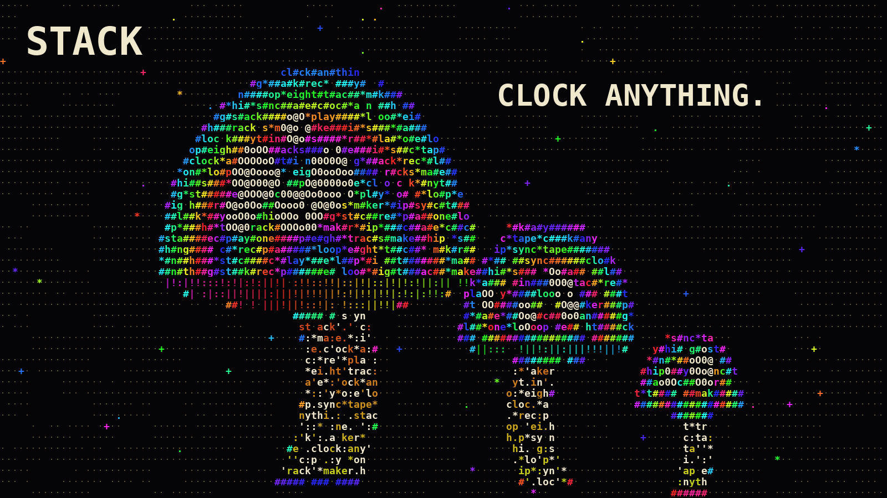

# STACK

STACK is a firmware for the M-VAVE FM-1 by Maker Hip. Eight tracks, each with one sound from a single list; the keys
play the selected track, and four knobs shape it: pitch, a DJ filter, decay and level.

**This is a public beta, version {{VERSION}}.** Not everything is finished, and it has not been tried on many FM-1s
yet. You install it at your own risk, and the installer can put M-VAVE's own firmware back.

- [Install](install/) it from Chrome or Edge, with the FM-1 connected by USB.
- Read the [manual](manual/).
- [Try it in the browser](emu/). It runs the same code as the FM-1.
- [Download {{PKG}}](firmware/{{PKG}}).
- The [Source](https://github.com/perawoga2-coder/stack) is under MPL-2.0. It's built on fm1-base and felucca-bsp,
  which come from Felucca by Leo Kuroshita, Hügelton Instruments.

M-VAVE and FM-1 are trademarks of their owners. STACK is not affiliated with M-VAVE.
